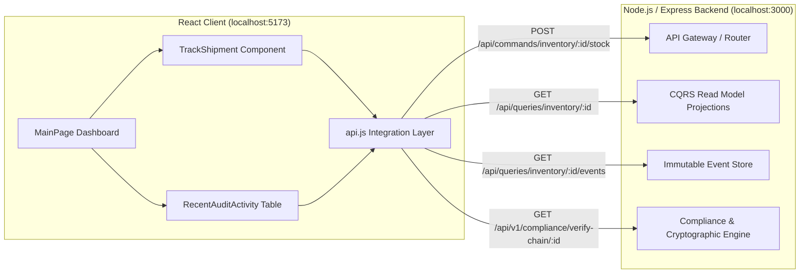

# 🌐 Day 24: Frontend-Backend API Integration & Live Logistics Ledger Dashboard

Building upon our event-sourced CQRS architecture, **Day 24** establishes full-stack integration between our React (Vite) client and Node.js/Express event-sourced backend APIs.

---

## 1. Architectural Highlights



---

## 2. Implemented Components & Services

### A. Frontend-Backend API Integration Layer (`frontend/src/services/api.js`)
- **Axios/Fetch Unified Client**: Connects securely to `http://localhost:3000` (or through Vite `/api` proxy).
- **Zero-Trust Security Headers**: Pre-configures Bearer tokens, `x-user-id`, and `x-user-role: LOGISTICS_MANAGER`.
- **Core Endpoints Integrated**:
  - `getShipmentReadModel(id)`: Queries CQRS materialized read model (`GET /api/queries/inventory/:id`).
  - `getShipmentAuditHistory(id)`: Fetches chronological immutable event stream (`GET /api/queries/inventory/:id/events`).
  - `getRealtimeMetrics()`: Ingests real-time materialized aggregate stats (`GET /api/queries/analytics/realtime`).
  - `verifyCryptographicChain(id)`: Queries SHA-256 cryptographic chain continuity (`GET /api/v1/compliance/verify-chain/:id`).
  - `dispatchStockMovement(id, delta, location)`: Dispatches live CQRS write commands (`POST /api/commands/inventory/:id/stock`).

### B. Real-Time Shipment Tracking Interface (`frontend/src/components/TrackShipment.jsx`)
- **Dynamic Live Card**: Takes any Shipment ID (e.g., `SHP-10024`) and displays:
  - **Status**: Live color-coded tags (`IN TRANSIT`, `DELIVERED`, `ORDER CREATED`, `CUSTOMS CLEARED`).
  - **Origin**: Consignment origin hub (e.g., `Mumbai Hub`).
  - **Destination**: Destination warehouse (e.g., `Delhi Warehouse`).
  - **Last Updated Time**: Formatted timestamp with real-time refresh capability.
  - **SKU & Tracked Units**: Materialized view metrics.
- **Interactive Controls**: Instant search, sample preset chips (`SHP-10024`, `MACBOOK-M3-MAX`, `ITEM-MUMBAI-BAY4`), and refresh spinner.

### C. Chronological Audit Activity Dashboard (`frontend/src/components/RecentAuditActivity.jsx`)
- **Event-Sourced Ledger Table**:
  - **Seq / Version**: Tagged version identifier (`v1`, `v2`, `v3`).
  - **Event Name**: Formatted domain event name (`Order Created`, `Dispatched`, `Customs Cleared`, `Stock Added`).
  - **Location**: Event checkpoint location.
  - **Timestamp**: Human-readable chronological event record.
  - **Status Badges**: Visual indicator (`Success`, `In Transit`, `Processing`, `Audit Alert`).
  - **Actor / Signer**: Cryptographic provenance actor ID.
  - **Ledger Hash**: Immutable SHA-256 block hash preview with hover tooltip.

---

## 3. How to Run Frontend & Backend Together

### Terminal 1 (Backend Core Service):
```bash
# From workspace root
npm start
# Server listens at http://localhost:3000
```

### Terminal 2 (React Frontend Dashboard):
```bash
cd frontend
npm install
npm run dev
# Vite runs at http://localhost:5173
```

Open **`http://localhost:5173`** in your browser to experience the real-time logistics dashboard!
